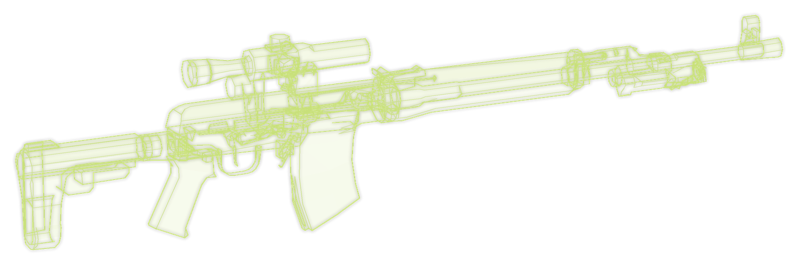

<!--
  The mod-page description, in the same dress as ACCESS GRANTED's.
  Paste everything below this comment into the listing.

  The Forge allows no background or styling of its own (raw HTML is stripped), so the look
  comes from images, plus three Forge extras:
    - a blockquote followed by a line "{.is-info}" / "{.is-danger}" becomes a coloured box;
    - "## Title {.tabset}" turns the ### headings under it into tabs, up to the next ## heading
      (there is no closing marker: a stray "{.endtabset}" shows as text);
    - a YouTube link on a line of its own embeds a player.
  Check it in the Forge editor's preview before saving.

  Images are served from the repository (docs/images), so they show once pushed to main.
    hero-v4.webp (animated, 8 s loop) and thumbnail.png: scripts/make_title.py (--thumb for the thumbnail)
    units.png: scripts/make_units.py; both share scripts/art_kit.py
    armoury.png and wireframes/: scripts/make_showcase.py
  Thumbnail: thumbnail.png, square; the Forge crops to 1:1.

  Short-description field:
    "Your launch becomes your faction's field terminal: the real load steps, 3D weapon debriefs and live operations, in a different BEAR or USEC unit every time."
-->

From the splash screen to the main menu, your launch becomes your faction's field terminal. It shows what EFT is really loading, timed against your own launches, while a different BEAR or USEC unit briefs you on the table beside it: 3D weapons, live operations and intercepted radio traffic. And when the raid is over, it's there to bring you home.

> **USEC  //  S3 OPERATIONS  //  SECRET//REL USEC**
>
> **TO:** All teams
>
> **RE:** Network sign-in
>
> ────────────────────────────────────
>
> Every operator signs in to the tactical net at start-up. Your session opens on whichever section has the watch, with its current orders, intelligence and kit on the table.
>
> The net is secure. BEAR is not reading this.
>
> *SIGNED: [REDACTED], BATTLE CAPTAIN  //  REF OPS-2281*

{.is-info}

> **BEAR  //  ШТАБ ГРУППИРОВКИ  //  СОВЕРШЕННО СЕКРЕТНО**
>
> **ПРИКАЗ:** всем группам
>
> ────────────────────────────────────
>
> При запуске каждый боец входит в сеть. Перехваченные переговоры противника читать вслух запрещается.
>
> *Every fighter signs in at start-up. Reading the enemy's intercepted traffic aloud is forbidden.*
>
> *Приложение: перехваченное сообщение USEC «BEAR is not reading this». Прочитано.*
>
> *Attached: intercepted USEC message "BEAR is not reading this". Read.*
>
> *ПОДПИСЬ: [ИЗЪЯТО], НАЧАЛЬНИК ШТАБА*

{.is-danger}

## Why you're seeing this

Norvinsk is cut off, and the contract that brought you here ended the day the lockdown began. Nobody came to collect the equipment.

The networks are still up. Every time you start EFT, your terminal signs in to your side's net and lands on whichever section has the watch. You see what they see: their orders, their map, the kit on their table, and whatever they've picked up from the other side's radios.

It knows your name. It knows your faction. It knows which tasks you've taken on, and it will ask how they're going.

When you come back from a raid, it's already waiting. It doesn't ask how it went. It already read the after-action report.

The other side's terminal says the same about you.

## Order of battle

Twelve units, six a side, each with its own colours, insignia frame, background, intro, progress bar and ending, shuffled so the same one won't come back for several launches. Your profile's faction decides which six you get.

| BEAR | USEC | On the table |
|---|---|---|
| Command Post | Tactical Operations Center | Assault plans, with team status or aerial imagery |
| Reconnaissance | S2 Intelligence | Drone orbits, aerial imagery, personnel files |
| Signals | S6 Communications | Direction finding, radio intercepts |
| Counterintelligence | Corporate Command | Personnel files, with surveillance or team status |
| Supply | S4 Logistics | Convoy routes, supply reports |
| Medical Service | Medical // Casevac | Casualty evacuation, supply reports |

Each one goes by several names and mottos, and BEAR's speaks Russian unless you tell it otherwise.

## The armoury

Nearly eighty weapons and over a hundred pieces of gear, drawn as turning 3D holograms from the game's own models. Each weapon comes in seven random builds put together from parts that really fit it, and every attachment on it is named.

## Intercepted traffic

> **ПЕРЕХВАТ 0412  //  INTERCEPT 0412  //  CUSTOMS AO**
>
> **USEC-2:** Overwatch, Two. Three BEAR moving west past the gas station.
>
> **USEC-6:** Copy, Two. Hold. Do not engage.
>
> **USEC-2:** They're going through our crate.
>
> **USEC-6:** Hold.
>
> **USEC-2:** They found the coffee.
>
> **UNKNOWN:** Спасибо за кофе. *(Thanks for the coffee.)*
>
> *TRANSCRIPT ENDS. FREQUENCY COMPROMISED. COFFEE NOT RECOVERED.*

The Signals units type these out on a radio spectrum while you load. The orders that come in alongside them sometimes mention you by name. Usually not to say well done.

## Field manual {.tabset}

### What it does

- **The real load.** Every step from verifying game files to opening the main menu, each with a live timer and a log of the ones done. The bar is timed against your own previous launches, and a step that runs long is flagged.
- **A weapons debrief.** A weapon and three pieces of gear build themselves on the table, one after another, with callouts naming the parts: a different optic, stock, magazine, grip or suppressor each time.
- **A second panel that changes every launch.** An operations map in each army's conventions, drone imagery with a firefight on the ground that goes over to infrared as the picture closes in, a radio spectrum with the transcript typing out, a wanted operator's personnel file, team and supply reports.
- **It knows your quests.** Your active tasks turn up on the tasking board and in the intelligence that comes in.
- **Traffic.** Orders, priority intel, intercepted enemy radio and a news ticker, slower on raid loads. Nothing repeats until you've seen the rest.
- **BEAR speaks Russian.** Steps, orders, chatter and labels. One setting turns it all to English.
- **The way home.** Once the after-action report is done, the terminal you signed in to covers the raid unloading and the menu loading. On by default.
- **Raid loading (optional).** The same terminal from the moment you press Ready, through the game's real load steps and the countdown, into the raid.

The terminal only draws over the load. It doesn't hold the game up.

### Install

Unzip into your SPT folder, so `CLASSIFIED.dll` lands in `BepInEx\plugins`. Then launch the game. Client only, no server part.

For SPT 4.1.x.

### Settings

In the F12 menu, under **CLASSIFIED**:

- **Faction** follows your profile, or always shows BEAR or USEC.
- **BEAR Language** is Russian or English.
- **Unit** keeps one unit, or leaves it on Random.
- **Glitches** can be Off, Subtle or Heavy.
- **Raid Loading** switches on the terminal for raid loads (off by default) and for the way back after a raid (on by default).

Tick **Advanced settings** for the rest: **Layout, Background, Insignia Frame, Intro, Progress Bar, Ending** each pin one part instead of letting the unit choose, and the **Preview** section holds the preview and the showreel.

**Want a look without relaunching?** Press **Ctrl+F6** in the main menu to play the terminal over a pretend load; the keys are listed along the bottom. **Showreel**, under Preview, plays every unit in turn.

### Compatibility

- [ACCESS GRANTED](https://github.com/JoelHauser/ACCESSGRANTED): the two take turns, launch by launch. **With ACCESS GRANTED** can always show one of them instead. Raid loads and the way back go to whichever terminal you signed in to.
- [Deploy Screen Overhaul](https://github.com/JoelHauser/LoadingRaid): both draw the raid loading screen, so this terminal stands aside for raid loads by default. **With Deploy Screen Overhaul** can take turns, or always show the terminal.

### Good to know

- The first launch uses rough step times, and picks a side at random until your profile loads. From the second launch on, the bar is timed against your own PC.
- If EFT shows an error while loading, the terminal gets out of the way at once.
- On a raid load, Esc cancels the raid while the game allows it.

### Uninstall

Delete `BepInEx\plugins\CLASSIFIED.dll`. To remove its settings and launch history too, delete the files starting with `com.mybutthasarash.classified` in `BepInEx\config`.

## End of transmission

*This page will be declassified in 75 years.*

*Конец связи. Out.*
