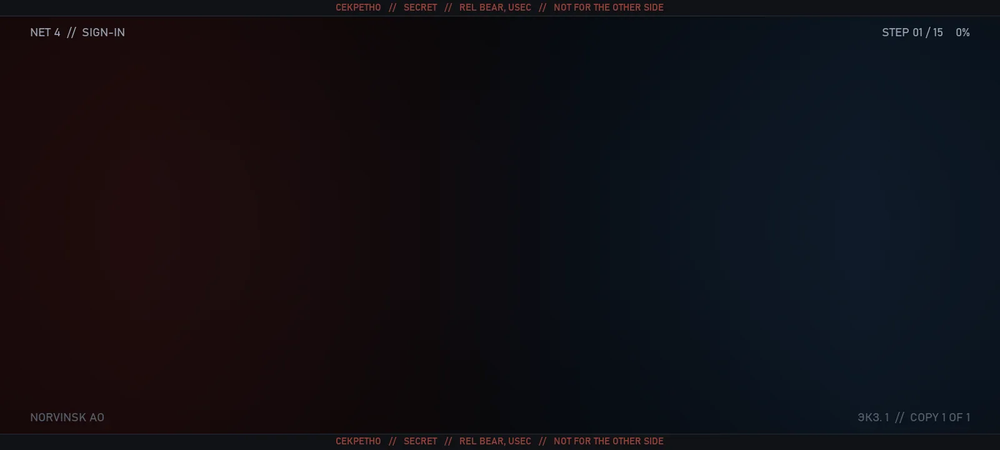
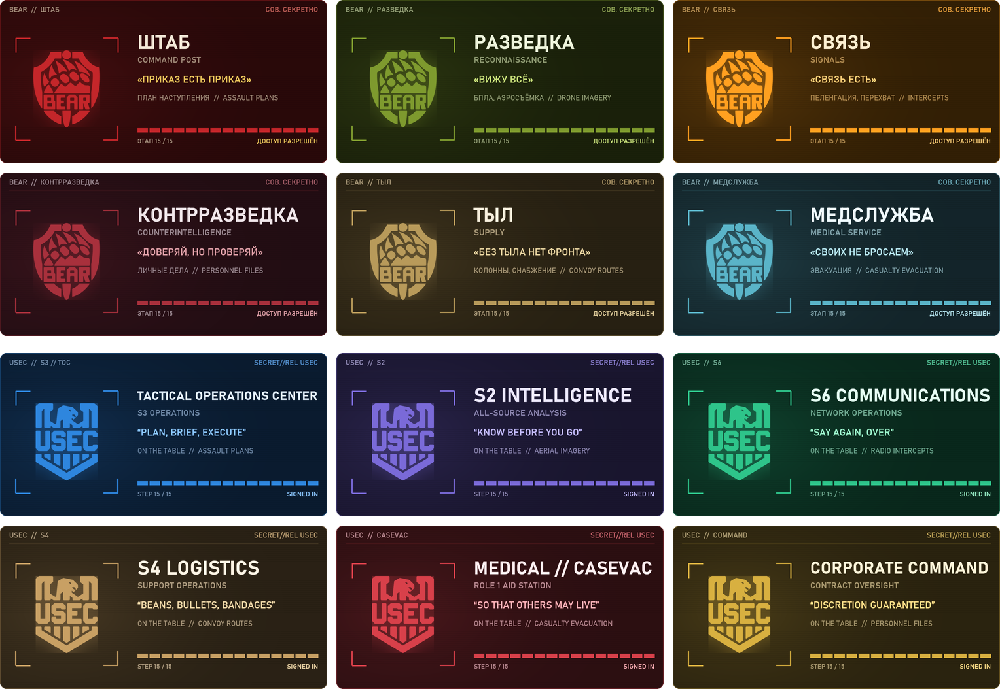
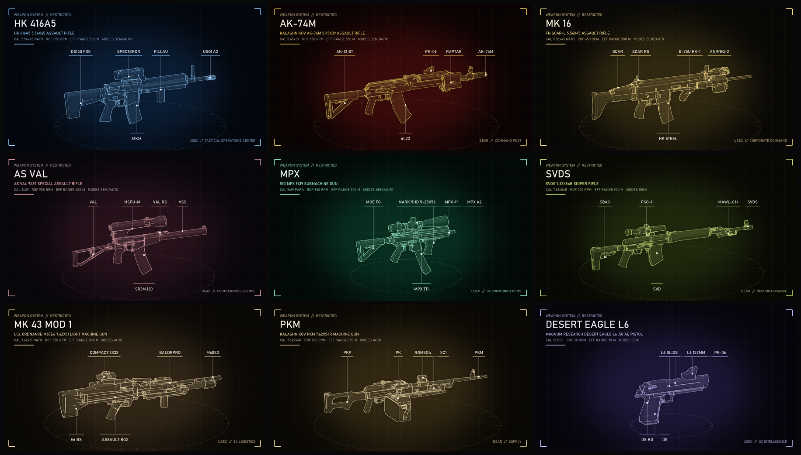

<!--
  The mod-page description. Paste everything below this comment into the listing.

  Written to answer "what does this mod do?" in the first lines: what it replaces, what you see,
  what it doesn't do. The flavour comes after that, not before.

  The Forge allows no background or styling of its own (raw HTML is stripped), so the look
  comes from images, plus Forge extras:
    - a blockquote followed by a line "{.is-info}" / "{.is-danger}" becomes a coloured box;
    - "## Title {.tabset}" turns the ### headings under it into tabs, up to the next ## heading
      (there is no closing marker: a stray "{.endtabset}" shows as text);
    - a YouTube link on a line of its own embeds a player.
  Check it in the Forge editor's preview before saving.

  Images are served from the repository (docs/images), so they show once pushed to main.
    hero-v4.webp (animated, 8 s loop) and thumbnail.png: scripts/make_title.py (--thumb for the thumbnail)
    units.png: scripts/make_units.py; both share scripts/art_kit.py
    armoury.png and wireframes/: scripts/make_showcase.py
  Thumbnail: thumbnail.png, square; the Forge crops to 1:1.

  Short-description field:
    "Replaces EFT's loading screens with a BEAR or USEC field terminal: the game's real load steps and timings, 3D weapon debriefs, maps and intel while you wait."
-->

> **What this mod does:** it replaces EFT's loading screens with a BEAR or USEC field terminal.
>
> - **When you start the game**, from the splash screen to the main menu.
> - **When you load into a raid**, from pressing Ready to spawning in. Optional, off by default.
> - **When you go back to the menu after a raid**, once the after-action report is done. On by default.
>
> The terminal shows what the game is actually loading, step by step and timed, with weapons, maps and intel from your faction to look at while you wait. It only changes what's on screen during loading: no gameplay changes, and loading takes as long as it always did.

{.is-info}

## What you see

- **The real load.** Every step the game goes through, from verifying files to opening the main menu, each with a live timer and a log of the finished ones. The progress bar is timed against your own previous launches, and a step that runs long is flagged.
- **Your faction's terminal.** BEAR players get a BEAR unit, USEC players a USEC one, a different one of six each launch. Each unit has its own colours, insignia frame, background, intro, progress bar and ending.
- **A weapon on the table.** A 3D hologram of a real weapon build from the game's own models turns beside the readout, with three pieces of gear and every attachment named.
- **A second panel.** Depending on the unit: an operations map, drone footage, a radio spectrum, a wanted operator's file, or team and supply reports.
- **Notices while you load.** Orders, intel on bosses, enemy teams and traders, and intercepted enemy radio: up to six a load, one after another. Some mention your nickname, and some your active tasks.
- **BEAR speaks Russian.** Steps, orders and labels, with one setting to switch it all to English.

## The twelve units

Six for each faction, shuffled so the same one doesn't come back for several launches. Your profile's faction decides which six you get.

## The weapons

Nearly eighty weapons and over a hundred pieces of gear, drawn from the game's own models. Each weapon comes in seven random builds made from parts that really fit it.

## The idea

Norvinsk is cut off, but your side's network is still running. Each time you start the game, your terminal signs in and lands on whichever unit has the watch, and you see what they see while the game loads.

## Field manual {.tabset}

### Install

Unzip into your SPT folder, so `CLASSIFIED.dll` lands in `BepInEx\plugins`. Then launch the game. Client only, no server part.

For SPT 4.1.x.

### Settings

In the F12 menu, under **CLASSIFIED**:

- **Faction** follows your profile, or always shows BEAR or USEC.
- **BEAR Language** is Russian or English.
- **Unit** keeps one unit, or leaves it on Random.
- **Glitches** can be Off, Subtle or Heavy.
- **Raid Loading** switches the terminal on for raid loads (off by default) and for the way back after a raid (on by default).

Tick **Advanced settings** for the rest: **Layout, Background, Insignia Frame, Intro, Progress Bar, Ending** each pin one part instead of letting the unit choose, and the **Preview** section holds the preview and the showreel.

**Want a look without relaunching?** Press **Ctrl+F6** in the main menu to play the terminal over a pretend load. **Showreel**, under Preview, plays every unit in turn.

### Compatibility

- [ACCESS GRANTED](https://github.com/JoelHauser/ACCESSGRANTED): the two take turns, launch by launch. **With ACCESS GRANTED** can always show one of them instead. Raid loads and the way back go to whichever terminal you signed in to.
- [Deploy Screen Overhaul](https://github.com/JoelHauser/LoadingRaid): both replace the raid loading screen, so this terminal stands aside for raid loads by default. **With Deploy Screen Overhaul** can take turns, or always show the terminal.

### Good to know

- **Does it make loading faster?** No. It shows you what's loading and how long each step takes; the load itself is untouched.
- **Does it change gameplay?** No. It only draws over the loading screens and never takes your mouse or keyboard (except Esc to cancel a raid load, while the game allows it).
- The first launch uses rough step times and picks a side at random until your profile loads. From the second launch on, the bar is timed against your own PC.
- If EFT shows an error while loading, the terminal gets out of the way at once.

### Uninstall

Delete `BepInEx\plugins\CLASSIFIED.dll`. To remove its settings and launch history too, delete the files starting with `com.mybutthasarash.classified` in `BepInEx\config`.
